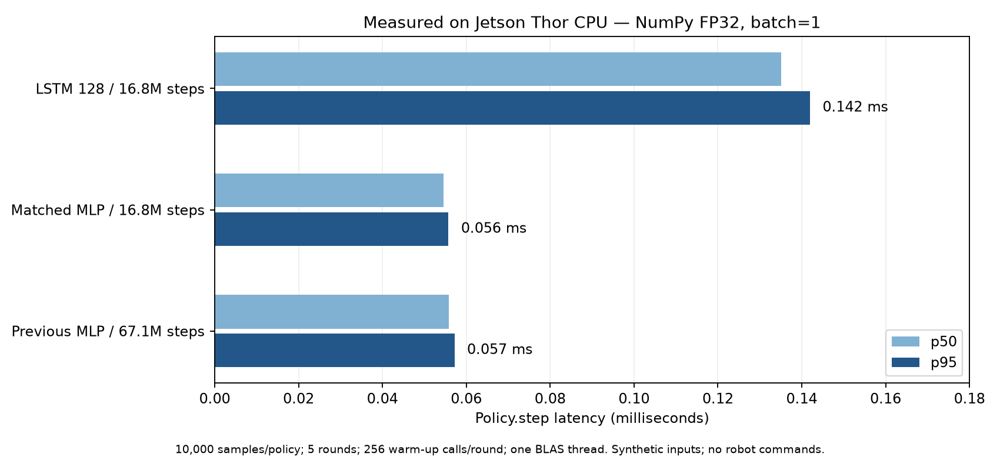

# Jetson Thor 강화학습 정책 설치·추론 검증

## 작업 위치

- 코드: `piper-sim-lab/scripts/deployment/benchmark_target.py`.
- Thor release: `/home/pi_lab/robot/releases/thor-20261021-r1`.
- Thor 전용 환경: `/home/pi_lab/robot/envs/policy-r1`.
- Thor 결과: `/home/pi_lab/robot/results/thor-validation-20261021-r1`.
- 3090의 원본 결과 사본: `/data/projects/piper-sim-lab/artifacts/thor-validation-20261021-r1`.
- Git에 보관한 요약: [validation-summary.json](evidence/thor/validation-summary.json).

## 목적

3090에서 학습한 LSTM과 MLP를 ARM64 Thor에서 실행하고, 원래 정책과 출력이 일치하는지와 정책 연산 시간을 확인한다. 비전–정책 연결 전의 목표 장치 실행 검증이다.

## 이 작업에서 다루는 범위

2026-10-21 SSH/SFTP로 35,821,665-byte 배포 묶음을 홈 아래에 전송했다. 압축 checksum과 파일 228개를 검증하고 NumPy runtime을 별도 환경에 설치했다. 세 정책의 export replay와 batch=1 CPU 추론 시간을 측정했다. 행동 출력 예시도 파일로 보관했다.

## 실제 수행 범위에서 빠진 부분

비전 코드·모델·환경은 변경하지 않았다. 이번에 카메라 촬영, 로봇 피드백 수집, IK/관절 target 변환, CAN/SDK 명령 전송은 수행하지 않았다. 입력은 **합성 export 검증 벡터**이며 실제 카메라 입력이나 파지 성공률 평가가 아니다. 실시간 제어 주기나 전체 파이프라인 지연도 아직 검증하지 않았다.

## 설치와 무결성

- Ubuntu 24.04/aarch64, 커널 `6.8.12-1021-tegra`.
- 기존 Conda base와 비전 환경을 유지하고 시스템 Python **3.12.3**으로 별도 venv를 생성했다.
- 이 속도 측정 당시 패키지: NumPy **1.26.4**, `piper-policy-runtime` **0.1.0**. 후속 실제 snapshot dry-run에서는 runtime을0.2.0으로 갱신했다. JAX, MuJoCo, PyTorch, Piper SDK는 이 환경에 설치하지 않았다.
- 첫 NumPy 2.5.4 wheel 다운로드가 불완전해 pip checksum 검사를 통과하지 못했다. 검사를 우회하지 않고 캐시를 사용하지 않는 NumPy 1.26.4 설치로 완료했다.
- r1의 `put -a` batch는 미존재 파일에서 실패했다. 최초 전송에는 `put`을 쓰는 `upload-thor-first-transfer.sftp`를 사용했다. archive 원본 bytes/checksum은 변경하지 않았다.
- setuptools가 release 소스 아래에 생성한 `build/`, `*.egg-info/` 파일은 원래 manifest와 비교한 후 이번 설치가 만든 파일만 제거했다. 이후 파일 집합과 SHA-256 228개를 다시 검증했다. 이후 설치는 release 소스를 임시 빌드 경로에 복사해서 진행한다.
- archive SHA-256: `9ceee4e05cf7b3bad8fefd4b6fae6a1c255fc335c0b3727c07ddf3b72ec672f2`.

## 수치 일치와 속도

| 정책 | 원래 JAX 출력과 최대 절대 오차 | p50 | p95 | p99 |
| --- | --- | --- | --- | --- |
| LSTM 1층·폭128, 1,677만 step | 8.64e-7 | 0.135ms | 0.142ms | 0.149ms |
| 같은 비교 학습기의 MLP, 1,677만 step | 4.17e-7 | 0.055ms | 0.056ms | 0.061ms |
| 기존 최종 MLP, 6,711만 step | 5.96e-7 | 0.056ms | 0.057ms | 0.063ms |

수치 일치는 원래 JAX 정책으로 저장한 합성 입력 80 step ×4개와 초기화 마스크를 재생했다. 세 정책 모두 허용 오차 `1e-4`를 통과했다. 이는 정책 변환·이식의 연산 일치 검사다.

속도는 NumPy FP32, CPU, batch=1, BLAS/OMP/MKL 스레드 1개에서 측정했다. 정책마다 5회 ×2,000회=**10,000회** 측정했으며 각 회차 전 256회 준비 실행을 했다. 회차마다 정책 실행 순서를 바꿨고, CPU affinity·전력 모드·GPU clock은 변경하지 않았다. 각 표본의 시간은 `Policy.step` 호출 직전부터 반환 직후까지이며 정규화·LSTM 상태 갱신을 포함한다.

모델 로딩, 관측 생성, 카메라·pose 추론, IK, SDK, 통신, 주기 스케줄링은 제외했다. p95는 측정 표본의 95%가 그 시간 이내라는 뜻이다. 실시간 deadline 보장이나 전체 처리량의 역수로 해석하지 않는다.

학습의 제어 주기는 `ctrl_dt=0.1s`(100ms)다. 이번 측정에서 정책 연산의 p95는 그 예산의 약 0.15% 이하였으므로, 다음 연결 단계는 비전 갱신 지연·입력 동기화·제어 변환을 확인하는 데 집중할 수 있다. 단독 CPU 측정만으로 GPU/TensorRT 최적화가 필요하다고 판단하지 않는다.



## 행동 출력은 어떻게 저장했나

각 정책의 `*-synthetic-actions.json`에 합성 검증 입력 첫 슬롯 80 step의 행동을 저장했다. 정규화 action7과 배포 설정에서 계산한 베이스 좌표 선속도(m/s)·각속도(rad/s), 그리퍼 열기/닫기 의도를 포함한다. 이 기록은 폐루프 rollout이 아니며 이전 행동 필드도 합성 검증 입력 그대로다.

예를 들어 LSTM의 첫 합성 입력은 action 약 `[0.068, -0.978, -0.582, 0.466, 0.767, -0.283, 0.567]`을 출력했다. 앞 3개에 0.1m/s, 다음 3개에 1rad/s를 곱하고 마지막 값의 양수 부호를 열기 의도로 해석했다. 실제 장면에서 이런 움직임이 적절하다는 뜻이 아니다. 이 값은 관절 목표각·SDK packet 자체가 아니며 실제 팔로 전송하지 않았다.

## 재실행

다음 명령은 로봇에 연결하지 않는다. 기존 결과를 덮어쓰지 않도록 새로운 output 경로를 사용한다.

```bash
OPENBLAS_NUM_THREADS=1 OMP_NUM_THREADS=1 MKL_NUM_THREADS=1 \
 /home/pi_lab/robot/envs/policy-r1/bin/python \
 /home/pi_lab/robot/tools/benchmark_target.py \
 --release /home/pi_lab/robot/releases/thor-20261021-r1 \
 --output /home/pi_lab/robot/results/새로운-검증이름
```

`benchmark.json`에 표본 30,000개의 시간, 회차별 통계, parity 결과, Python/NumPy 버전, 정책·입력·스크립트 해시를 보관했다. `installed-packages.txt`, `post-install-verification.json`도 같은 결과 디렉터리에 있다. 원본 사본의 `evidence-sha256.json`은 결과 파일의 무결성을 확인한다.

## 다음 통합 단계

현재는 V-model 검증 계획 중 **Thor 정책 실행 검증**까지 완료했다. [비전–정책 dry-run 인수인계](vision_policy_dry_run.md)에 실카메라 입력과 로봇 상태를 연결할 때의 누락 필드와 단계별 통과 기준을 정리했다. 다음은 실제 입력으로 action·명령 후보를 파일에 저장하는 shadow mode다. HIL과 실제 팔을 움직이는 시험은 별도 단계다.
