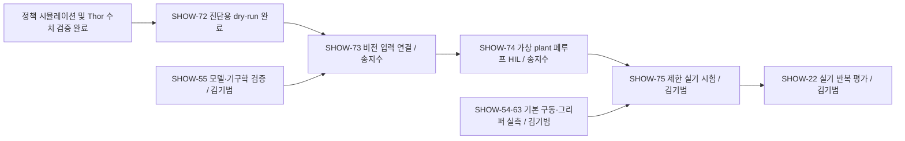

# 비전–강화학습 V-model 검증 계획

## 작업 위치

Plane ShowOnce의 실로봇 배포 모듈과 SHOW-17 하위 이슈로 관리한다. 비전은 Thor의 기존 `songjisu/show33`, 정책·어댑터는 `robot/releases`와 `robot/adapters`에 둔다. 코드 저장소와 runtime 패키지는 독립 구성으로 유지한다.

## 목적

최종 요구사항은 **실제 카메라·로봇 상태가 정책 관측으로 변환되고, 정책 행동이 의미가 맞는 명령으로 변환되어 Piper의 작업으로 이어지는 것**이다. 요구사항·설계마다 대응하는 시험과 증거를 연결한다.

V-model은 장비를 하나씩 붙이는 순서의 이름만은 아니다. 설계에서 정한 계약을 통합·시스템 검증으로 확인하는 개발 방식이다. SIL·타깃 실행·HIL은 그 검증에 쓰는 시험 형태다. [MathWorks V-model](https://www.mathworks.com/help/rtw/gs/v-model-for-system-development.html)

## 다루는 범위와 수행하지 않은 부분

이번에는 요구사항–검증 대응, 선행 조건, 담당자, 결과 보관 위치를 정한다. 시뮬레이션 학습과 Thor 정책 단독 검증, 실제 snapshot 진단용 dry-run까지 수행했다. 신뢰할 수 있는 실제 자세/제어 상태, HIL, 실기 구동·성공률은 아직 검증하지 않았다.

## 요구사항과 대응 시험

| ID | 확인하려는 요구사항 | 설계/구현 계약 | 대응하는 시험과 증거 |
| --- | --- | --- | --- |
| R1 | 실제 입력의 좌표·단위·시각·물체 역할이 맞는다. | 관측48개, 보정·치수·TCP 정의, 필드별 출처와 입력 나이. | SHOW-72 경로/거부 검사, SHOW-55 로봇 실측, SHOW-73 비전 입력 검증, SHOW-75 실제 장면 기록. |
| R2 | 옮긴 정책이 원래 정책과 같은 연산을 한다. | weights·normalizer·구조·LSTM reset을 함께 고정한다. | SHOW-71 export replay 오차<1e-4, SHOW-74 폐루프 비교. |
| R3 | action이 의도한 로봇 명령으로 변환된다. | twist→velocity IK→관절 목표/제한, 전체 폭·그리퍼 힘의 의미. | CPU MuJoCo 기준 회귀 검사, SHOW-55 단위/FK/TCP 검증·SHOW-63 그리퍼 실측, SHOW-74 HIL, SHOW-75 저속 실기. |
| R4 | dry-run은 로봇 구동 명령을 보내지 않는다. | 수신 전용 CAN과 전송 코드 없는 JSON sink를 분리한다. | SHOW-72 CAN TX 증가0·명령 후보 파일·코드 검사. |
| R5 | 실시간 단계에서 제어 주기와 입력 나이를 만족한다. | 정책 주기100ms, 센서 갱신과 제어 루프를 분리하고 오래된 입력을 차단한다. | SHOW-74 전체 루프 지연·deadline 초과·입력 나이 측정, SHOW-75 실제 지연 확인. |
| R6 | 누락·비정상·오래된 입력을 감지하고 출력/상태를 처리한다. | 보정·유실·단위·범위 검사, episode/reset·재시작 규칙. | SHOW-72 단위 테스트/strict 거부, SHOW-74 오류 주입과 복구, SHOW-75 정지 동작. |

R5의 구체적인 pose/관절 허용 나이는 정책의 학습 지연 설정과 실제 센서·제어기 측정을 함께 보고 확정한다. 학습의 지연 랜덤화 범위가 센서 오차에 대한 무조건적인 보장은 아니다.

## 순서와 담당자

| 순서 | Plane 이슈 | 현재 상태 | 담당/통과 기준 |
| --- | --- | --- | --- |
| 기준 | SHOW-69·71: 시뮬 정책·Thor 실행 | 완료 | 학습/평가와 정책 수치 일치·CPU 속도 기록 확보. 정식 컴파일 PIL이라고 부르지 않는다. |
| 1 | SHOW-72: 실제 snapshot 진단용 dry-run | 완료 | Codex가 실행. 실카메라+실제 CAN→관측→행동/관절 후보 파일, 전송0. 실기 적합성은 미통과. |
| 로봇 준비 | SHOW-55: 시뮬–실기 모델 통일·기구학 검증 | Todo | **김기범**. 모델 버전/해시·FK/TCP·관절/폭·target 규약·장착 좌표를 확정한다. SHOW-54 기본 구동과 SHOW-63 그리퍼 실측도 담당한다. |
| 2 | SHOW-73: 카메라 보정·물체 자세와 RL 관측 연결 | Todo | **송지수**. 카메라 좌표/치수·입력 시각·관측 변환을 검증한다. 로봇 규약은 SHOW-55에서 받고, 실측에 필요한 실제 팔 이동은 김기범이 수행한다. |
| 3 | SHOW-74: Thor↔가상 Piper HIL | Backlog | **송지수**, 김기범 지원. SHOW-73 통과 후 실제 Thor 출력이 가상 plant를 바꾸고 다음 관측으로 돌아오는 폐루프·지연·오류 처리를 검증한다. |
| 4 | SHOW-75: 제한된 실기 시험 | Backlog | **김기범**, 송지수 비전·기록 지원. SHOW-74·54·63 통과 후 현장에서 저속·제한 동작/정지·전체 파이프라인을 확인한다. |
| 5 | SHOW-22: 실기 반복 평가·시연 기록 | Todo | **김기범**, 송지수 비전·영상 지원. SHOW-75 제한 시험 통과 후 반복 성공률과 실패 유형을 기록한다. |

Plane 선행 의존성은 **SHOW-72 →73 →74 →75 →22**, **SHOW-55 →73**, **SHOW-54·63 →75**다. 앞 단계의 완료 문구와 실제 통과 범위를 함께 읽는다. 특히 SHOW-72 Done은 진단용 경로의 완료이며 보정/실기 적용 통과를 대신하지 않는다.

실카메라와 CAN을 읽고 후보를 파일에 저장하는 것은 shadow/dry-run이다. **HIL은 실제 제어 하드웨어와 가상 plant가 입출력 피드백을 이루는 시험**이며, 실제 팔을 움직이는 시험과 구분한다. [NI HIL 설명](https://www.ni.com/en/solutions/transportation/hardware-in-the-loop/what-is-hardware-in-the-loop-.html)

## 팀 인수인계

송지수는 SHOW-73의 비전 입력 연결을, 김기범은 SHOW-55의 모델·기구학 검증을 진행한다. [실제 dry-run 결과](vision_policy_dry_run_result.md)의 사진·좌표 오류·폭/치수 가정·가상 target·전체42.13초 지연을 함께 확인한다. 기존 비전 모델을 다시 받을 필요는 없다. 진단 어댑터를 실기 송신기로 바꾸기 전에 입력과 제어 변환을 확정한다.

김기범은 SHOW-35·54·56의 실제 팔 구동, SHOW-63 그리퍼 실측, SHOW-75·22 실기 평가를 맡는다. SHOW-61은 송지수가 물체 자세에서 파지 후보를 만들고 김기범이 IK·도달 가능성·실기 접근을 검증한다. 카메라 보정용 자세 변경도 김기범이 실행하고 송지수가 영상·좌표를 기록한다. 기본 구동·보정용 제한 이동은 정책 HIL 이전에 진행할 수 있고, 정책 폐루프의 실제 팔 구동은 SHOW-74 통과 후 진행한다.

전찬욱은 강화학습과 정책 평가를 맡는다. 김기범이 모델 기하·TCP의 변경 근거와 고정한 모델을 전달하면 기존 정책을 재평가하고 필요한 경우 재학습한다. SHOW-24 관측·명령 규약은 세 사람이 함께 맞춘다.

이슈 본문에는 작업 위치·목적·범위·빠진 부분을 먼저 쓰고, 측정 결과·사진·다음 통과 기준을 분리한다. 실행마다 코드/정책/보정 해시와 원본 기록을 남긴다. 이번 실제 결과 원본은 Thor의 `robot/results/vision-rl-20261021T092756Z-pipeline`에 있다.
