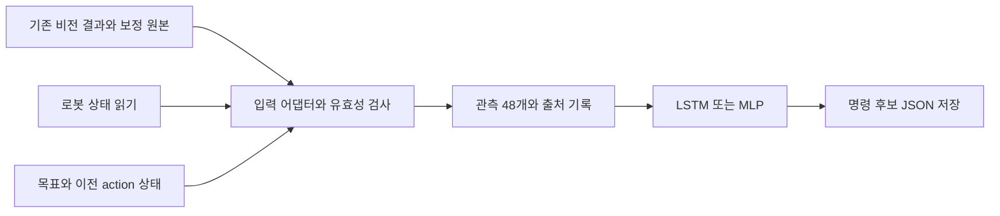

# 비전–강화학습 연결: 움직이지 않고 명령 후보 확인하기

후속으로 실제 카메라+수신 전용 CAN을 연결한 진단용 snapshot dry-run을 실행했다. [실제 결과·사진·남은 한계](vision_policy_dry_run_result.md), [V-model 순서·담당자](v_model_validation_plan.md)를 참고한다. 아래 비전 코드 점검은 실행 전 조사 기록이다.

## 작업 위치

- 강화학습 코드: `/home/jeonchanwook/work/piper-sim-lab`
- Thor 기존 비전 프로젝트: `/home/pi_lab/songjisu/show33`
- 기존 비전 환경: `/home/pi_lab/songjisu/envs/perception`(Python 3.12), `/home/pi_lab/songjisu/envs/fpose`(Python 3.11)
- 기존 비전 모델: `/home/pi_lab/songjisu/models`
- 점검 방식: 2026-10-21 SSH로 원격 코드·설정·기존 결과 파일만 읽었다. 비전 코드·가중치·환경을 변경하지 않았다.

## 목적

실제 카메라와 로봇 상태를 정책 입력으로 변환하고, LSTM·MLP가 어떤 행동을 제안하는지 기록한다. 첫 연결 단계의 출력은 파일이며, 로봇 구동 명령을 전송하지 않는다. 이후 시뮬레이터 피드백을 포함한 검증과 제한된 실기 시험으로 범위를 넓힌다.

## 이 문서에서 다루는 범위

기존 비전 출력과 정책 입력의 차이, 연결 인터페이스 제안, 단계별 검증 기준을 정리한다. 정책 설치·수치 일치·Thor 추론 속도 결과는 별도의 배포 검증 기록으로 관리한다.

## 실제 수행 범위에서 빠진 부분

이번 비전 점검에서는 카메라 촬영, SAM·FoundationPose 실행, CAN 수신, 관절·그리퍼 명령 전송을 수행하지 않았다. 이 조사 이후 실제 카메라 snapshot → 정책 → 명령 후보 기록을 실행했다. **실시간 연속 제어와 실기 적합성은 아직 검증하지 않았다.** 기존 저장 결과를 읽은 사실은 실시간 통합 성공이나 실기 집기 성공의 증거가 아니다.

## 확인한 비전 입출력

`/home/pi_lab/songjisu/show33/run.sh` 기본 모드는 다음 순서의 일회 실행이다.

1. `scripts/capture.py`: RealSense RGB-D를 촬영한다. 기본값은 depth 15프레임의 중앙값이며 정지 장면을 가정한다.
2. `scripts/segment.py`: SAM 3 마스크를 만든다.
3. `scripts/pose_fp.py`, `scripts/pose_geom.py`: FoundationPose++와 기하 추정을 수행한다. FP++가 실패하면 기하 추정으로 진행할 수 있다.
4. `scripts/export_poses.py`: 카메라 자세를 로봇 베이스 좌표로 변환해 `runs/<시각>/object_poses.json`을 저장한다.

`scene` 모드는 로봇으로 카메라 외부 보정을 추정하고 자동 발견한 물체를 기하 추정한다. 기본 모드와 추정기·물체 ID가 다르므로 호출 모드와 실제 사용한 추정기를 함께 기록해야 한다. 현재 인터페이스는 연속 pose 스트림이 아니다.

출력은 `frame: piper_base_link`, `units: m`, `stamp`, `camera_to_base`, `objects[]`를 포함한다. 물체별 필드는 `id`, `pos[3]`, `quat_wxyz[4]`, `size`, `mesh`, `estimator`, 선택적 `checks`이다. `stamp`는 export 시각이며 카메라 노출 시각이나 관절 수신 시각을 대신하지 않는다.

### 현재 파일을 그대로 정책에 넣을 수 없는 이유

- `/home/pi_lab/songjisu/show33/calib/T_base_cam.json`은 `trusted: false`이다. 확인한 최신 결과의 `runs/20261021-161540/T_base_cam_robot.json`도 `trusted: false`이며 `mask_iou: 0.5803`, `depth_resid_median_mm: 7.53`을 기록한다. 이는 기존 파일의 값이며 이번에 재측정한 값이 아니다.
- `export_poses.py`는 보정 신뢰도 경고를 출력하지만 `object_poses.json`에 `trusted`를 포함하지 않는다. 소비자는 보정 원본과 연결해 신뢰도를 보존해야 한다.
- `runs/20261021-161540/object_poses.json`은 `obj0_stuffed_animal`, `obj1_block` 등 자동 ID와 `pointcloud` 크기를 사용하며 bowl이 없다. 정책의 block·bowl 역할을 임의로 대응시키면 안 된다.
- 기본 `config/objects.json`은 예전 3cm 빨간 블록(`half_extents: [0.015, 0.015, 0.015]`)을 정의한다. 현재 내보낸 정책은 5cm 큐브(`block_half: 0.025`)를 사용해 학습했다. 실제 대상의 치수와 중심 정의를 확인해야 한다.
- 학습 기본 배치 영역은 block의 x=0.25~0.40m, y=−0.15~−0.02m, bowl의 x=0.25~0.35m, y=0.12~0.20m이다. 확인한 실제 장면의 후보 블록은 음의 x에 있다. 좌표축을 임의로 뒤집어 맞추지 말고 보정·작업 배치를 확인한다.

## 정책 입력 48개와 필요한 연결 작업

기준은 `runtime`으로 내보낸 각 정책의 `policy.json`과 `src/piper_sim_lab/pick_place.py`다. 배열 범위는 Python 슬라이스처럼 끝 인덱스를 포함하지 않는다.

| 범위 | 정책이 기대하는 값 | 현재 확인된 입력 / 남은 작업 |
|---|---|---|
| 0:6 | 관절 위치, rad | `scripts/read_joints.py`는 `q_deg`를 출력한다. rad로 변환한다. |
| 6:12 | 관절 속도, rad/s | 현재 JSON에 없다. 시간 정보가 있는 피드백 또는 시간 차분·필터 설계가 필요하다. |
| 12:18 | 관절 목표 − 측정 위치, rad | 현재 목표를 보존하는 controller state가 필요하다. 입력 누락을 0으로 숨기지 않는다. |
| 18:21 | TCP 위치, 베이스 좌표 m | 관절 FK와 TCP 정의를 통일해야 한다. |
| 21:24 | TCP 회전벡터, rad | 학습에서는 link6 방향을 사용한다. FK 결과와 회전벡터 변환을 검증한다. |
| 24:25 | 그리퍼 전체 폭, m | `read_joints.py`의 `grip_m`은 한 손가락 이동량이다. 전체 폭은 ×2이며 수신 유효성도 확인한다. |
| 25:28 | block 중심 위치, m | 명시적으로 선택한 물체 ID, 중심 정의, 보정 신뢰도, 시각이 필요하다. |
| 28:31 | block 회전벡터, rad | `quat_wxyz`를 학습 코드와 동일한 규약으로 변환한다. 대칭 물체의 자세 정규화도 일치시킨다. |
| 31:34 | bowl 위치, m | 현재 장면 파일에 없다. 실제 인식 결과나 명시적 보정된 고정 목표가 필요하다. 고정값이면 그 출처를 표시한다. |
| 34:37 | block − TCP, m | 같은 좌표계·시간 기준에서 계산한다. |
| 37:40 | block − bowl, m | 유효한 block·bowl 입력에서 계산한다. |
| 40:41 | 인식된 큐브 한 변의 절반, m | `pointcloud`의 보이는 면 크기를 큐브 치수로 자동 간주하지 않는다. |
| 41:48 | 이전 정규화 action 7개 | 실행별 상태에 보존하고 episode 시작 시 0으로 초기화한다. LSTM 메모리도 함께 reset한다. |

### 기구학·회전 규약

학습 TCP는 link6 로컬 `[0, 0, 0.12]m`이다. 기존 비전의 `scripts/goto_above.py`는 메시 끝점에서 TCP를 추정한다. `show33/robot_model.py`에는 제조사 URDF와 학습용 Menagerie MJCF의 link6 위치가 최대 11mm 다르다는 설명이 있다. 실제 적용 전 동일 관절각의 FK 위치·방향과 TCP를 비교해야 한다.

학습의 `_quat_to_rotvec()`는 wxyz quaternion을 직접 변환한다. 일반 라이브러리의 최단 회전 표현이나 quaternion 부호 정규화를 무조건 적용하면 표현이 달라질 수 있다. 영회전·π 근처·q와 −q 사례를 포함해 학습 구현과 일치시키고, 자세 추정의 대칭 처리도 고정한다.

## 제안하는 연결 인터페이스

다음 파일·스키마는 **제안**이며 이번 점검에서 구현·실행한 결과가 아니다. 비전 프로젝트를 고치기보다 별도 어댑터가 기존 파일을 읽도록 한다.

- `vision_snapshot`: 기존 `object_poses.json` 경로·해시, 촬영 시각, export 시각, 보정 경로·신뢰도, 선택한 block·bowl ID. 자동으로 가장 최근 디렉터리를 선택하기보다 실행에서 파일을 명시한다.
- `robot_state`: 수신 시각, 관절 위치·속도, 전체 그리퍼 폭, FK의 위치·방향, frame·단위. CAN 수신부와 명령 전송부를 분리한다.
- `controller_state`: 현재 관절 target, 이전 action, episode ID, LSTM reset 여부. shadow 실행에서 유지하는 가상 target은 실제 로봇에 전송된 target과 구별한다.
- `observation_record`: 48차원 벡터, 필드별 원본·시각, 누락·지연·보정 경고. task 입력이 빠지면 유효한 통합 시험으로 처리하지 않는다. 합성 입력은 별도의 synthetic replay로 표시한다.
- `proposed_command`: 정책·가중치 해시, 정규화 action7, 변환된 명령 후보, 입력 유효성, `hardware_commands_sent: false`. 파일 기록용 sink에는 로봇 SDK의 전송 경로를 넣지 않는다.

### 행동 출력은 관절 명령과 다르다

정책의 앞 6개 출력은 베이스 좌표의 선속도·각속도 요청이다. 현재 정책 설정에서는 정규화 값에 각각 `0.10m/s`, `1.0rad/s`를 곱한다. 7번째는 `>0`이면 열기, 그 외에는 닫기인 이진 그리퍼 요청이다. 이 의미는 배포할 정책의 `policy.json`에서 읽어야 한다.

학습 환경은 감쇠 역기구학, 관절 속도 제한, 목표 누적·측정값과의 차이 제한, 관절 한계를 거쳐 관절 target을 만든다. 그리퍼도 목표 변화율과 힘 상한을 적용한다. 따라서 action을 그대로 `JointCtrl`에 넣으면 안 된다. shadow 단계에서는 우선 속도·그리퍼 요청을 저장하고, 실제 명령 후보까지 확인할 때에는 같은 의미의 변환기와 실기 effort 보정을 별도로 검증한다. 이번 문서는 이 변환기나 CAN 명령 전송을 완료했다고 주장하지 않는다.

## V-model에 맞춘 단계별 통과 기준

V-model은 요구사항·설계 각각에 대응하는 검증을 계획하는 개발 방식이다. SIL·PIL·HIL은 그 안에서 활용하는 시험 형태다. 단순히 장비를 하나씩 붙이는 순서의 이름은 아니다. [MathWorks V-model 설명](https://www.mathworks.com/help/rtw/gs/v-model-for-system-development.html)

아래 단계와 기준은 이 프로젝트를 위한 제안이다. 실제 시험 기록에는 요구사항 ID, 코드·가중치 버전, 입력 데이터, 결과 파일, 통과 여부를 연결한다.

| 단계 | 구성과 확인할 것 | 다음 단계로 가기 전 남길 증거 |
|---|---|---|
| 1. 시뮬레이션·SIL | PC에서 배포할 정책·변환기를 시뮬레이터와 연결한다. 학습 평가와 별도로 입력/행동 의미를 검사한다. | 동일 관측의 수치 일치, 메모리 reset, 명령 제한·누락 입력 처리, 시뮬레이터 피드백을 받는 폐루프 실행 기록. |
| 2. Thor 정책 검증 | Thor에서 저장 관측을 재생하고 LSTM·MLP 수치 일치와 추론 시간을 잰다. PIL 취지를 참고한 타깃 실행 검증이다. | 동일 테스트 입력·오차 허용치·원본 출력, latency 분포, 환경·코어/스레드 설정. Python/NumPy 실행이므로 컴파일된 object code의 정식 PIL 검증이라고 부르지 않는다. |
| 3. 카메라·관절 상태 shadow mode | 실제 센서 입력 → 정책 → 명령 후보 파일을 연결한다. 구동 출력은 전송하지 않는다. | 촬영·수신·추론 시각, 보정·물체 역할·48차원 입력의 유효성, 출력 시계열, 지연·입력 유실 시 처리. 실제 카메라 프레임과 명령 후보를 대응시킨 기록. |
| 4. HIL | 실제 Thor 제어 소프트웨어의 출력이 시뮬레이션 plant로 들어가고, 그 반응이 Thor 입력으로 돌아오는 폐루프를 만든다. 필요하면 I/O 에뮬레이터를 포함한다. | 제어 주기 준수, 동기화, 단위·축·제한, 센서 유실·통신 지연·비정상 입력 주입 결과. plant 응답이 루프에 없으면 이 단계 완료로 표시하지 않는다. |
| 5. 제한된 실기 시험 | 앞 단계에서 확인한 버전으로 제한된 작업 공간·속도에서 실제 움직임을 시험한다. | 기구학·그리퍼 힘 보정, 실행 제한과 정지 동작 확인, 영상·상태·명령 동시 기록, 성공·실패 조건을 정의한 반복 시험 결과. |

실제 카메라와 로봇 피드백을 읽기만 하며 출력은 기록하는 단계는 **shadow mode**다. 장비가 포함되었다는 이유만으로 HIL이라고 부르지 않는다. HIL은 실제 제어 하드웨어와 가상 plant의 입출력이 연결되어 피드백을 이루는 시험이다. 실제 팔·물체를 움직이는 폐루프는 실기 시험으로 구분한다. [NI HIL 설명](https://www.ni.com/en/solutions/transportation/hardware-in-the-loop/what-is-hardware-in-the-loop-.html)

후속 SHOW-72에서 실제 snapshot·관절 상태를 관측으로 변환하고 구동 전송 없이 action·관절 목표 후보와 경고를 기록했다. 보정/치수/실기 FK·target 검증은 미통과다. SHOW-73에서 송지수 학생이 비전 입력 연결을 이어가며, 로봇 모델·FK/TCP·target 규약과 실제 팔 이동은 SHOW-55 등에서 김기범 학생이 담당한다.
