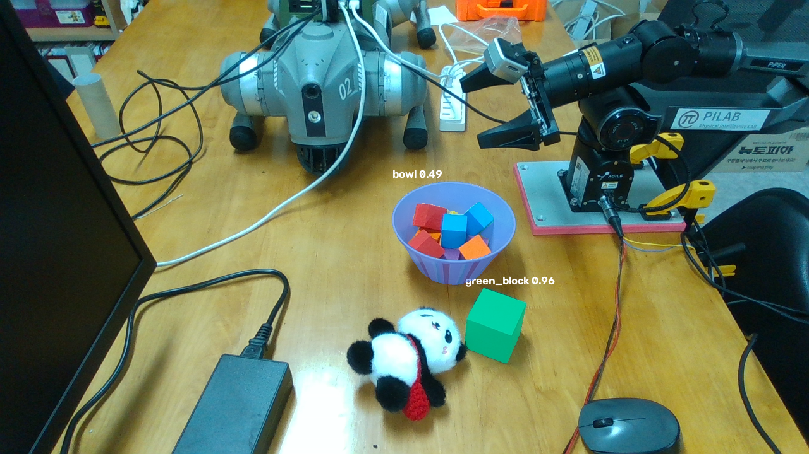
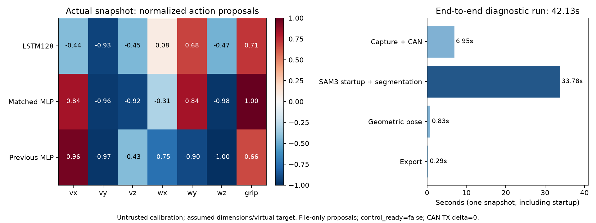

# 실제 카메라–강화학습 진단용 dry-run 결과

## 작업 위치

- Thor 실행기: `/home/pi_lab/robot/adapters/shadow-20261021-r1/run_shadow_snapshot.py`.
- Thor 결과: `/home/pi_lab/robot/results/vision-rl-20261021T092756Z-pipeline`.
- 3090 결과 사본: `/data/projects/piper-sim-lab/artifacts/vision-rl-20261021T092756Z-pipeline`.
- 코드: `scripts/deployment/{capture_shadow_inputs,run_shadow_snapshot}.py`, `runtime/src/piper_policy_runtime/{shadow,kinematics}.py`.
- Plane: SHOW-72. 사진·행동/시간 그림·결과 JSON을 첨부했다.

## 목적

실제 RGB-D와 실제 Piper 피드백에서 정책 입력을 만들고, LSTM·MLP가 어떤 행동과 관절 목표를 제안하는지 **명령을 전송하지 않고** 확인한다.

## 이 작업에서 다루는 범위

2026-10-21 한 명령으로 새 RGB-D 촬영과 동시 CAN 수신 → 기존 SAM 3 분할 → 기존 기하 자세 추정 → 관측48개 → 정책3개 → velocity IK·그리퍼 목표 후보 JSON을 생성했다. 사진의 초록 큐브와 그릇을 명시적으로 지정했다. 옛 사진이나 합성 정책 검증 벡터를 이번 입력으로 사용하지 않았다.

기존 비전 소스·설정·보정·패키지는 수정하지 않았다. 가중치를 다시 받지 않았고, FoundationPose++를 이번 실행에서 호출했다고 주장하지 않는다. 기존 비전의 **SAM 3 + geometric** 경로를 사용했다. 정책 환경만 runtime0.1.0에서0.2.0으로 갱신했다. 원래 r1 release와 정책 가중치는 그대로다.

## 실제 수행 범위에서 빠진 부분

카메라 외부 보정이 `trusted=false`이고 물체 치수를 실측하지 않아 **실기 적용 가능한 통합 검증은 통과하지 않았다**. 실제 servo target을 읽은 것이 아니라, 측정 관절각으로 초기화한 가상 shadow target을 사용했다. 학습용 FK/TCP의 실기 정합·속도 피드백 단위의 실측도 미완료다.

입력은 이번에 촬영한 실제 장면을 저장한 **단일 snapshot**이다. 실시간 연속 추적, 가림 복구, LSTM의 여러 실카메라 프레임 이력, HIL 폐루프, 실제 팔 구동·파지 성공률은 시험하지 않았다. LSTM cell/hidden과 이전 action은 새 shadow episode의 첫 step으로 명시적으로 초기화했다.

## 실제 입력과 행동 후보



CAN 수신은 SocketCAN의 `recv`만 사용했다. SDK 초기화·조회·enable·구동 함수를 호출하지 않았다. 촬영 시각 이전의 최신 피드백을 사용했으며 모든 필드의 최대 수신 나이는 **8.92ms**였다. 이는 호스트 수신 시각 기준이며 카메라 노출과 CAN의 하드웨어 동기화를 입증하지 않는다. 깊이는 정지 장면을 가정한5프레임 중앙값이다.

촬영 구간 CAN 전송 카운터는 **29,685 →29,685, 증가0**이었다. 이후 비전·정책·IK 단계에는 CAN 연결 코드가 없다.

| 정책 | 정규화 action7의 실제 출력 |
| --- | --- |
| LSTM128 | `[-0.437, -0.926, -0.451, 0.085, 0.677, -0.473, 0.711]` |
| 비교 MLP | `[0.835, -0.960, -0.918, -0.308, 0.836, -0.975, 0.998]` |
| 기존 최종 MLP | `[0.958, -0.974, -0.433, -0.749, -0.901, -0.999, 0.660]` |

앞3개는 베이스 좌표 선속도 요청(×0.1m/s), 다음3개는 각속도 요청(×1rad/s), 마지막은 그리퍼 요청이다. 이 장면에서 세 정책 모두 열기를 제안했다. 출력 차이는 첫 snapshot의 관측/기억 상태에서 나온 예시이며 성능 우열이나 적절한 실제 움직임을 뜻하지 않는다.

NumPy velocity IK는 학습과 같은 TCP·Jacobian·감쇠·속도 제한·target 누적·관절 제한을 적용해 **관절 목표 후보6개**도 저장한다. 전체 그리퍼 폭 후보와 effort 미보정 상태를 함께 기록한다. 관절 목표는 SDK packet이 아니고 실제로 전송하지 않았다.



## 시간: 정책 단독과 전체 snapshot을 구분

| 측정 범위 | 시간 |
| --- | ---: |
| 촬영+CAN 수신 단계 | 6.95초 |
| SAM 3 로딩·전처리·분할 등 전체 subprocess | 33.78초 |
| 기하 자세 추정 | 0.83초 |
| 자세 export | 0.29초 |
| 전체 한 번의 snapshot 파이프라인 | **42.13초** |
| 카메라 수신 시각부터 정책 진단까지의 입력 나이 | **39.74초** |

이는 시작 비용을 포함한 파일 파이프라인 측정이다. SAM 모델 forward만의 시간이나 지속 실행 처리량이 아니다. [이전 정책 단독 CPU 측정](thor_validation.md)의 LSTM p95 0.142ms와 혼동하면 안 된다. 현재 경로는 **10Hz 실시간 제어에 사용할 수 없다**. 모델 상주 실행·pose 갱신/추적·입력 나이 제한은 후속 단계에서 검증해야 한다.

## 실기 전환을 막은 근거

- 보정 신뢰도 미확정. 큐브 중심 추정 z가 **−5.2mm**, 큐브 주변 테이블이 약−30mm, 그릇 주변 테이블이 약+73mm로 서로 다르다. SAM이 물체를 검출했다는 사실이 베이스 좌표 자세의 정확성을 뜻하지 않는다.
- 큐브 한 변50mm와 그릇 치수는 정책 설정에서 가져온 **미검증 가정**이다. 기하 추정의 큐브 높이는33.5mm였다. 이를 실측 치수로 저장하지 않았다.
- 실제 전체 그리퍼 폭 **96.3mm**는 학습 설정 최대70mm보다 크다. 관측값은 실제96.3mm를 유지하고, 시뮬레이션 목표 생성에만 제한을 적용했다.
- 실제 물체 위치는 학습 reset 영역 밖이다. 실측 보정·배치 확인 없이 축이나 좌표를 임의로 바꾸지 않았다.
- controller target은 측정 q에서 시작한 가상 target이며 실제 servo target이 아니다. 실기 속도 단위·FK/TCP와 물체 자세의 정확성도 아직 확인하지 못했다.

기본 strict 실행은 위 조건으로 **정책 실행을 거부하고 종료 코드2**를 반환했다. 명시적 `--diagnostic-only --virtual-target-at-measured` 실행만 수치 후보를 생성했다. 모든 기록의 `control_ready=false`, `hardware_commands_sent=false`를 유지했다. 이 어댑터에는 실기 구동을 켜는 옵션이 없다.

## 재실행과 결과 파일

Thor에서 새 결과 경로로 실행한다. 기존 결과를 덮어쓰지 않는다.

```bash
/usr/bin/python3 /home/pi_lab/robot/adapters/shadow-20261021-r1/run_shadow_snapshot.py \
 --output /home/pi_lab/robot/results/새로운-dry-run-이름
```

- `camera/`: 실제 RGB-D, 내부 파라미터, 센서/호스트 시각, 마스크와 물체 자세.
- `robot_feedback.json`: 실제 관절 위치·속도·전체 폭, 필드별 수신 시각과 나이.
- `task.json`, `calibration_snapshot.json`: 이번 실행의 치수 가정과 보정 사본.
- `strict/report.json`: 검증 거부 이유.
- `diagnostic/{observation,proposed_commands,report}.json`: 관측·행동·관절 목표 후보·경고·출처 해시.
- `capture_report.json`, `pipeline_report.json`, 단계별 `.log`: CAN 송신 증가0과 처리 시간.
- `evidence-sha256.json`: 원본 결과 파일25개 무결성. 3090 사본에서도 모두 검사했다.

## 코드 검증과 다음 단계

CPU 테스트 **26개 통과**: 실제 export 수치 일치, 관측 누락/지연/잘못된 좌표 거부, 진단 모드에서도 누락 물체를 만들지 않는 동작, CAN 부호/단위·시각 선택, MuJoCo C 기준 FK/Jacobian/학습 제어 변환 비교를 포함한다.

현재는 **진단용 dry-run 경로 완료**다. 송지수 학생은 SHOW-73 비전 입력 연결과 SHOW-74 HIL을, 김기범 학생은 SHOW-55 로봇 모델·기구학 검증과 SHOW-75 제한 실기 시험을 맡는다. 카메라 보정에 필요한 실제 팔 이동도 김기범 학생이 담당한다. [V-model 요구사항·검증 계획](v_model_validation_plan.md)의 순서와 통과 기준을 따른다.
